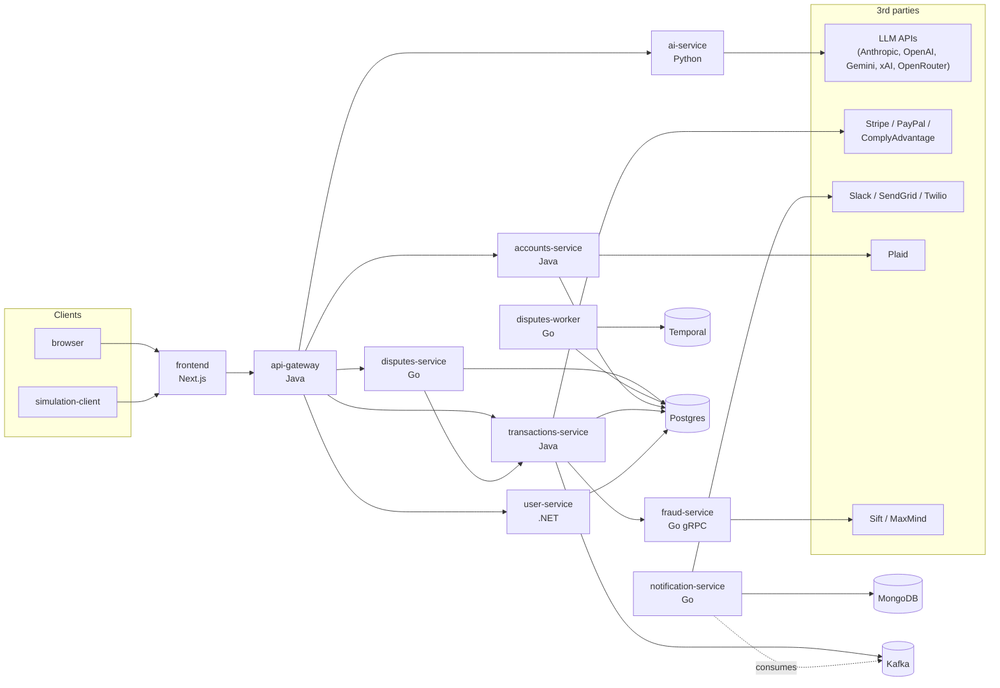

# Banking Application - Microservices

A multi-language banking application with HTTP, gRPC, Kafka, Postgres, MongoDB, and LLM provider integrations. The stack is designed for local development, Kubernetes deployment, observability, and traffic-based service isolation.

## Quick Start

### Run Everything Locally (Docker Compose)
```bash
# Start all services and observability stack
docker-compose up -d

# Access the application and tools
open http://localhost:3000      # Frontend (Next.js 15)
open http://localhost:3001      # Grafana (admin/admin)
open http://localhost:9090      # Prometheus
open http://localhost:16686     # Jaeger
```

### Deploy to Kubernetes
```bash
# Deploy the full app with traffic replay support
kubectl apply -k kubernetes/overlays/speedscale/

# Or deploy without Speedscale routing
kubectl apply -k kubernetes/overlays/local/

# Access the application via your cluster's ingress / load balancer
```

## Architecture

Eight application backend services across four languages, a Next.js frontend, and a load-generating simulation client.

| Service | Language | Purpose |
|---|---|---|
| `api-gateway` | Java (Spring Cloud Gateway) | Edge router, JWT auth, and edge resilience controls |
| `user-service` | .NET (ASP.NET Core) | Authentication, profile management |
| `accounts-service` | Java (Spring Boot) | Account + balance management, Plaid integration |
| `transactions-service` | Java (Spring Boot) | Transaction processing, Stripe / PayPal / ComplyAdvantage integrations |
| `ai-service` | Python (FastAPI) | Chat endpoint that fans out to 5 LLM providers (Anthropic, OpenAI, Gemini, xAI, OpenRouter) and aggregates the replies |
| `fraud-service` | Go (gRPC h2c on :8080) | Fraud risk scoring with Sift / MaxMind / Stripe Radar |
| `disputes-service` | Go | Transfer dispute intake, operator review, and Temporal escalation |
| `notification-service` | Go | Slack / SendGrid / Twilio fan-out for transaction events from Kafka |
| `frontend` | Next.js 15 / React 19 | Server-side proxy + UI |
| `simulation-client` | Node.js | Drives realistic user-session traffic with burst and negative-path patterns |

**Storage / messaging:** PostgreSQL (per-service schemas), MongoDB, Kafka (transaction event stream).

**Observability:** OpenTelemetry -> otel-collector -> Jaeger (traces) + Prometheus (metrics) + Loki (logs) + Grafana (dashboards).

How **OpenTelemetry trace data** is processed in-process (SDK) and after export (OTLP -> collector on Kubernetes, or direct to Jaeger in Docker Compose) is documented with Mermaid diagrams in [OBSERVABILITY.md - OpenTelemetry trace data processing](./OBSERVABILITY.md#opentelemetry-trace-data-processing) and [architecture.md - OTel trace data processing](./architecture.md#otel-trace-data-processing).



## Traffic Replay

The `speedscale` overlay deploys the app alongside the Speedscale operator and binds every service to a recorded snapshot via a `TrafficReplay` (responder-only mode):

| Workload | Recorded snapshot serves |
|---|---|
| `banking-ai` | All 5 LLM provider responses |
| `banking-accounts` | Plaid balance lookups |
| `banking-transactions` | Stripe, PayPal, ComplyAdvantage |
| `banking-fraud` | Sift, MaxMind, Stripe Radar |
| `banking-notification` | Slack, SendGrid, Twilio |
| `banking-user` | Auth dependencies |

The operator's mutating webhook injects a `speedscale-initproxy-responder` init container into each app pod, which rewrites `/etc/hosts` so outbound third-party hostnames resolve to the in-cluster responder. The responder matches each outbound request by signature (host + method + URL path + body shape) and serves the recorded response.

A PostSync hook (`kubernetes/overlays/speedscale/responders/tr-postsync-reroll.yaml`) rolls any workload whose pods are missing the responder init container after every ArgoCD sync, so a webhook race during a rolling deploy can't silently disable the responder for one of the services.

## Development

### Individual Service Development

Build and run a Java service from its module directory:

```bash
cd backend/accounts-service
mvn package
mvn spring-boot:run
```

### Frontend Development
```bash
cd frontend
npm install
npm run dev            # Development server at http://localhost:3000
npm run build          # Production build
npm test               # Run tests
```

### Database Operations
```bash
# Postgres
psql -h localhost -p 5432 -U postgres -d banking_app

# Mongo
mongosh mongodb://localhost:27017/banking_app

# Run migrations (from a Java service directory)
./mvnw flyway:migrate
```

## Testing

The [banking journey coverage matrix](./docs/banking-journey-coverage.md) tracks
route contracts and evidence across test layers.

### Backend Tests
```bash
# Java services
./mvnw test
./mvnw verify -P integration-tests

# Go services
cd backend/fraud-service && go test ./...

# Python service
cd backend/ai-service && pytest
```

### Frontend Tests
```bash
cd frontend
npm test               # Unit tests
npm run test:e2e       # End-to-end tests
```

### Temporal Banking Integration

Run `make test-integration-temporal` for the isolated Compose scenarios.
They check frontend identity, a transfer through the ledger, Kafka, MongoDB
and notification providers, deposits and withdrawals, statements, and AI
provider fan-out. Each scenario writes a sanitized report under
`tests/integration/temporal/results/`.

Use `make test-integration-temporal-ui` to follow the transfer and worker
replacement in Temporal UI. The command prints the exact workflow history
URL. Set `TEMPORAL_TEST_UI_PORT` to change the default port (8233) or
`TEMPORAL_TEST_UI_HOLD` to change the default two-minute inspection window.

The [integration test guide](./tests/integration/README.md) includes a
transfer walkthrough and commands for the browser and recovery checks.

### Transfer Disputes

In local Compose, customers can select **Dispute transfer** on completed
transfers or visit `/disputes` to review their cases. To enable the
`/operations/disputes` queue for designated users, set
`DISPUTES_OPERATOR_IDS` to their comma-separated user IDs before starting
Compose. The allowlist defaults to empty. Operators can record a resolution
summary of up to 2,000 characters.

The API saves a dispute and its workflow-start outbox entry in PostgreSQL.
The worker runs on the `disputes-escalation` task queue and escalates open
cases 24 hours after filing. An operator can request one written response
for cases filed after rollout. Customers have seven days to respond. The
case stays eligible for escalation while the request is pending, then
returns to operator review after a response or timeout. A resolution
closes any pending request and records the decision without moving funds.
Pre-rollout cases continue through the original escalation and resolution paths.

### Statement Exports

From an account page, use **Request JSON statement** to queue an export.
The Compose `statement-worker` runs on the `accounts-statement-exports`
task queue and uses the account state at generation time. The authenticated
download is available for seven days after generation. A failed export can
be requested again. The existing synchronous export endpoint remains available.

The [integration test guide](./tests/integration/README.md) covers both
browser journeys and worker replacement. Run
`bash scripts/workflow-proto.sh` from the repository root to verify and
regenerate the workflow bindings with Buf 1.57.0, protoc 31.1, and
protoc-gen-go 1.36.9.

### CI Replay Validation

The required `proxymock-validation` CI job checks user-service against the recordings in `backend/user-service/proxymock/recorded-complete/`. Run the same check locally from the repository root:

```bash
make proxymock-validation
# If local Postgres occupies port 5432:
make proxymock-validation-docker
```

These fixtures and validation scripts support application tests. Keep optional recordings, standalone traffic-analysis tools, and internal demonstration workflows outside this repository.

## Key Features

- **Authentication**: JWT-based authentication with HttpOnly cookies
- **Observability**: Distributed tracing (OTel + Jaeger), Prometheus metrics, Loki logs, Grafana dashboards
- **Speedscale integration**: Responder mocks for every third party, deterministic replay
- **Development Tools**: Service-specific build and test commands
- **Container Ready**: Docker and Kubernetes deployment configurations
- **Load generation**: Simulation client drives realistic burst traffic with configurable negative-path coverage

## Version Management

The project uses semantic versioning with all services sharing the same version number:

```bash
# Check current version
make version                          # Shows: 1.4.75

# Bump version
make version-bump BUMP_TYPE=patch     # 1.4.75 -> 1.4.76
make version-bump BUMP_TYPE=minor     # 1.4.75 -> 1.5.0
make version-bump BUMP_TYPE=major     # 1.4.75 -> 2.0.0

# Update all files and Kubernetes manifests
make version-bump BUMP_TYPE=patch && make update-k8s-version

# Build and deploy with new version
make docker-build-versioned           # Build images with version tag
kubectl apply -k kubernetes/overlays/speedscale/
```

## Documentation

- **[AGENTS.md](./AGENTS.md)** — Guidance for AI assistants and automated agents
- **[TROUBLESHOOTING.md](./TROUBLESHOOTING.md)** — Comprehensive debugging guide
- **[OBSERVABILITY.md](./OBSERVABILITY.md)** — Monitoring, tracing, and metrics setup
- **[PLAN.md](./PLAN.md)** — Detailed implementation phases and testing criteria
- **[architecture.md](./architecture.md)** — System architecture and design decisions

## Getting Started

1. **Prerequisites**: Docker, Docker Compose, Node.js 20+, Java 17+, Maven 3.8+, Go 1.21+, Python 3.12+
2. **Quick start**: Run `docker-compose up -d` to start everything
3. **Development**: Use service-specific Makefiles for isolated development
4. **Testing**: Run service tests and the CI replay validation above
5. **Deployment**: Use Kubernetes manifests for production deployment

## Health Checks

Verify all services are running:
```bash
curl http://localhost:8080/actuator/health  # API Gateway
curl http://localhost:8081/actuator/health  # User Service
curl http://localhost:8082/actuator/health  # Accounts Service
curl http://localhost:8083/actuator/health  # Transactions Service
curl http://localhost:8084/health           # AI Service (FastAPI)
curl http://localhost:8085/health           # Notification Service (Go)
curl http://localhost:3000/api/health       # Frontend
# fraud-service speaks gRPC; use `grpcurl localhost:8086 list`
```

---

For detailed troubleshooting, monitoring setup, and development workflows, see the documentation files listed above.
