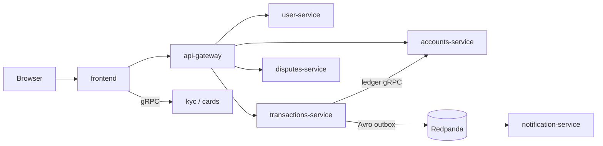

# Banking Application

Multi-language banking stack for local development, Kubernetes, observability, and traffic isolation. HTTP, gRPC, Kafka (Redpanda), PostgreSQL, MongoDB, and optional LLM providers.

## Quick start

```bash
docker compose up -d
open http://localhost:3000      # Frontend
open http://localhost:3001      # Grafana
open http://localhost:9090      # Prometheus
open http://localhost:16686     # Jaeger
```

Register a user, sign in, and create an account. Demo scripts:

| Script | What it covers |
|---|---|
| [`scripts/demo/walkthrough.sh`](scripts/demo/walkthrough.sh) | Transfer, dispute, statement, KYC, card, fixture AI chat |
| [`scripts/demo/failure-scenarios.sh`](scripts/demo/failure-scenarios.sh) | Kafka pause, fraud stop, Grafana outbox panel |
| [`scripts/certs/dev-ca.sh`](scripts/certs/dev-ca.sh) + `docker-compose.mtls.yml` | Optional mTLS for KYC / cards / fraud |

If the gateway exits on an OpenTelemetry `ContainerAttributes` error, see [TROUBLESHOOTING.md](TROUBLESHOOTING.md#gateway-exits-during-opentelemetry-startup).

### Environments

| Environment | Includes |
|---|---|
| Default Compose | Identity, accounts, transactions, fraud, KYC, cards, disputes, workers, fixture AI, Postgres, Redis, Redpanda, MongoDB, notifications, OTel/Jaeger/Prometheus/Grafana |
| Kubernetes base / local | Core banking + AI + notifications + simulation (no disputes workers by default) |
| Kubernetes full overlay | Base + disputes/statement/KYC/AI workers + Temporal |
| Payments overlay | Optional outbound AUD payments (Temporal, Artemis, settlement) |
| Temporal integration | Isolated journey scenarios ([tests/integration/README.md](tests/integration/README.md)) |

Cluster setup: [kubernetes/README.md](kubernetes/README.md).

## Services

Interactive diagrams: [`docs/architecture/`](docs/architecture/). Design notes: [`architecture.md`](architecture.md).

| Service | Stack | Role |
|---|---|---|
| `api-gateway` | Java / Spring Cloud Gateway | Edge routing, JWT, resilience |
| `user-service` | .NET | Auth and profiles |
| `accounts-service` | Java | Accounts, balances, ledger gRPC `:9092` |
| `transactions-service` | Java | Movements, outbox events, query gRPC `:9095` |
| `fraud-service` | Go gRPC `:8080` | Risk scoring |
| `kyc-service` | Go gRPC `:8091` | Identity review (+ Temporal worker) |
| `cards-service` | Go gRPC `:8092` | Virtual cards |
| `disputes-service` | Go | Dispute intake and Temporal escalation |
| `notification-service` | Go | Kafka → Slack / SendGrid / Twilio |
| `ai-service` / `ai-worker` | Python | Chat + Temporal banking agent |
| `payments-service` | Java (overlay) | Outbound payments |
| `frontend` | Next.js 16 | UI and server proxy |
| `simulation-client` | Node.js | Load generation (Kubernetes) |

**Data / messaging:** PostgreSQL (schema per service), MongoDB (notifications), Redpanda + Schema Registry (Avro by default; see [`contracts/avro/`](contracts/avro/README.md)).

**Observability:** OTLP → OpenTelemetry Collector → Jaeger; Prometheus metrics; Loki on Kubernetes. Trace flow diagrams: [OBSERVABILITY.md](OBSERVABILITY.md#opentelemetry-trace-data-processing).



Event topics, outbox quarantine/retention, and Schema Registry details: [`contracts/avro/README.md`](contracts/avro/README.md) and [`docs/money-movement-recovery.md`](docs/money-movement-recovery.md).

## Development

```bash
# Java (from repo root)
./gradlew :accounts-service:bootJar
./gradlew :accounts-service:bootRun
./gradlew :accounts-service:flywayMigrate   # needs FLYWAY_PASSWORD

# Frontend
cd frontend && npm ci && npm run dev

# Regenerate checked-in gRPC clients for the frontend
bash scripts/frontend-proto.sh
```

Contracts live under [`contracts/proto/`](contracts/proto/) and [`contracts/openapi/`](contracts/openapi/). PostgreSQL 18 → 19: [docs/postgresql-19-upgrade.md](docs/postgresql-19-upgrade.md).

### Local health checks

```bash
docker compose ps
curl -fsS http://localhost:3000/api/v1/healthz
curl -fsS http://localhost:8080/actuator/health   # gateway
curl -fsS http://localhost:8082/actuator/health   # accounts
curl -fsS http://localhost:8083/actuator/health   # transactions
```

Host port `8081` is shared by user-service and Schema Registry — prefer in-network checks (`redpanda:8081`, or `docker compose exec user-service …`). Fraud gRPC is on host `8086`; KYC `8091`; cards `8092`.

## Testing

Journey coverage matrix: [docs/banking-journey-coverage.md](docs/banking-journey-coverage.md).

```bash
./gradlew test                          # Java
cd backend/fraud-service && go test ./...
cd backend/ai-service && pytest
cd frontend && npm test && npm run test:e2e
make test-integration-temporal          # isolated Compose journeys
make test-integration-temporal-ui       # Temporal UI hold
```

| Area | Guide |
|---|---|
| Integration / recovery | [tests/integration/README.md](tests/integration/README.md) |
| Outbound payments | [Compose](docs/banking-journey-coverage.md#activemq-artemis-development-components) · [K8s](kubernetes/README.md#hybrid-outbound-payments) · [acceptance](tests/integration/README.md#outbound-payment-acceptance) |
| Offline WireMock replay | [`tests/replay/`](tests/replay/) · `make replay-gate` |
| Provider isolation (no third-party egress) | `make provider-isolation-deploy` · [overlay](kubernetes/overlays/provider-isolation/) |

## Versioning

- Global release: `VERSION` (`make version`, `make version-bump BUMP_TYPE=patch`)
- Java services: `backend/<service>/gradle.properties` (`serviceVersion`)
- Frontend / simulation / K8s image tags: synced by CI on merge to `master`

Policy: [AGENTS.md](AGENTS.md#version-bump-policy).

## Documentation

| Doc | Contents |
|---|---|
| [architecture.md](architecture.md) | Runtime topology and design decisions |
| [docs/architecture/](docs/architecture/) | Interactive Archify diagrams |
| [plan.md](plan.md) | Delivery milestones and remaining work |
| [OBSERVABILITY.md](OBSERVABILITY.md) | Tracing, metrics, dashboards |
| [TROUBLESHOOTING.md](TROUBLESHOOTING.md) | Debugging runbook |
| [docs/add-a-service.md](docs/add-a-service.md) | Adding a service |
| [docs/money-movement-recovery.md](docs/money-movement-recovery.md) | Movements, outbox, recovery |
| [AGENTS.md](AGENTS.md) | Guidance for automated agents |
| [docs/dependency-upgrade.md](docs/dependency-upgrade.md) | Dependency baseline and held versions |
