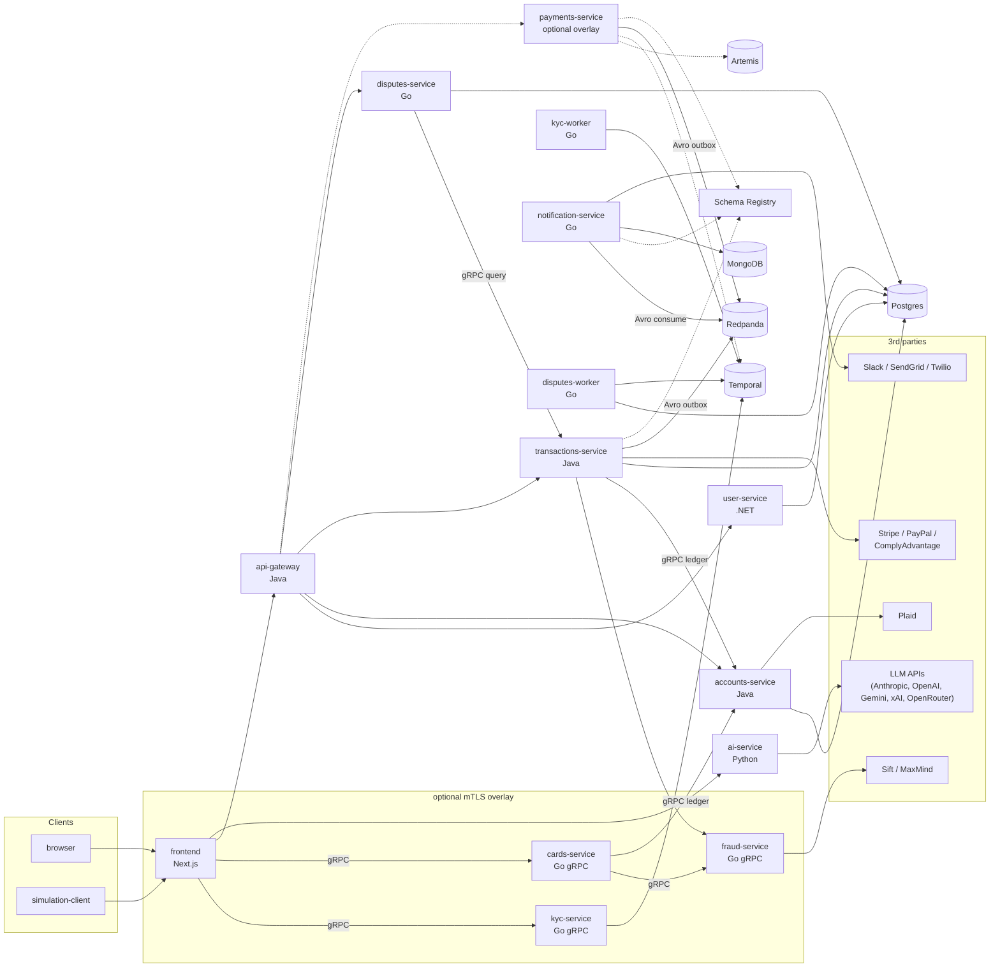
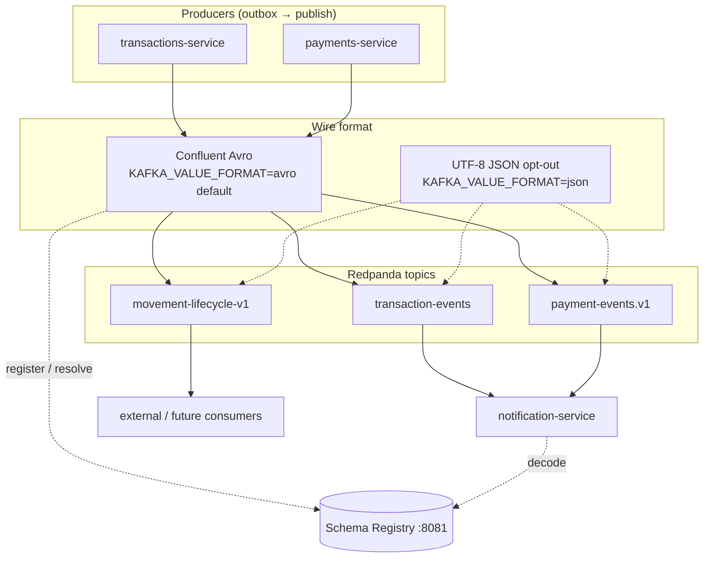

# Banking Application - Microservices

A multi-language banking application with HTTP, gRPC, Kafka, Postgres, MongoDB, and LLM provider integrations. The stack is designed for local development, Kubernetes deployment, observability, and traffic-based service isolation.

## Quick Start

### Run the Local Banking Stack (Docker Compose)
```bash
# Start the local banking stack
docker compose up -d

# Access the application and tools
open http://localhost:3000      # Frontend (Next.js 16)
open http://localhost:3001      # Grafana
open http://localhost:9090      # Prometheus
open http://localhost:16686     # Jaeger
```

Docker with the Compose plugin is sufficient for the container workflow.
Register a local user, then sign in and create an account. `scripts/demo/walkthrough.sh` does that path against the frontend, including a retried transfer, a dispute, a statement job, KYC approval, a virtual card purchase, and fixture AI chat. Cards and KYC are Go gRPC services. The Next.js server calls them with TypeScript generated from `contracts/proto/kyc/kyc.proto` and `contracts/proto/cards/cards.proto`. `scripts/certs/dev-ca.sh` and `docker compose -f docker-compose.yml -f docker-compose.mtls.yml up` enable mutual TLS for those calls. `scripts/demo/failure-scenarios.sh` pauses Kafka, stops fraud, and points at the Grafana outbox panel. Outbound payments stay on the optional Compose overlay. If the gateway
exits with an OpenTelemetry `ContainerAttributes` error, apply the
[local gateway workaround](TROUBLESHOOTING.md#gateway-exits-during-opentelemetry-startup).

| Environment | Features and dependencies |
|---|---|
| Default Compose | Identity, accounts, transactions, fraud, KYC, cards, disputes, statement/KYC/AI workers, fixture-backed AI chat, PostgreSQL, Redis, Redpanda, MongoDB, notifications, otel-collector, Jaeger, Prometheus, Grafana |
| Kubernetes base and local overlay | Identity, accounts, transactions, fraud, KYC, cards, AI, notifications, api-gateway, frontend, simulation, PostgreSQL, Redis, Redpanda, MongoDB |
| Kubernetes full overlay | Base services plus disputes (+ worker), statement worker, kyc-worker, ai-worker, and PostgreSQL-backed Temporal |
| Temporal integration stack | Isolated banking journeys with scenario-specific workers and provider fixtures |

Use the [Kubernetes deployment guide](kubernetes/README.md) for cluster setup and
[the integration test guide](tests/integration/README.md) for isolated scenarios.

## Architecture

Ten application backend services across four languages (plus optional `payments-service` on Compose/K8s overlays), a Next.js frontend, and a load-generating simulation client (Kubernetes). Interactive Archify diagrams live under [`docs/architecture/`](docs/architecture/).

| Service | Language | Purpose |
|---|---|---|
| `api-gateway` | Java (Spring Cloud Gateway) | Edge router, JWT auth, and edge resilience controls |
| `user-service` | .NET (ASP.NET Core) | Authentication, profile management |
| `accounts-service` | Java (Spring Boot) | Account + balance management, Plaid integration, ledger gRPC on `:9092` |
| `transactions-service` | Java (Spring Boot) | Transaction processing, Stripe / PayPal / ComplyAdvantage; query gRPC on `:9095` |
| `ai-service` / `ai-worker` | Python (FastAPI + Temporal) | Multi-provider chat fan-out plus durable banking agent (`ai-banking` queue): LiteLLM activities, hard-rule guardrails, read-only tools, claim-check history, and multi-agent dispute research drafts |
| `fraud-service` | Go (gRPC h2c on :8080) | Fraud risk scoring with Sift / MaxMind / Stripe Radar |
| `kyc-service` | Go (gRPC on :8091) | Customer identity review, with a Temporal worker |
| `cards-service` | Go (gRPC on :8092) | Virtual cards; calls fraud and accounts ledger over gRPC |
| `disputes-service` | Go | Transfer dispute intake, operator review, and Temporal escalation; eligibility via transactions query gRPC |
| `notification-service` | Go | Slack / SendGrid / Twilio fan-out for transaction events from Kafka |
| `frontend` | Next.js 16 / React 19 | Server-side proxy + UI |
| `simulation-client` | Node.js | Drives realistic user-session traffic with burst and negative-path patterns (Kubernetes) |

**Storage / messaging:** PostgreSQL (per-service schemas), MongoDB, and Redpanda (Kafka-compatible broker). Schema Registry listens on container port `:8081` (in Compose that host port collides with user-service — prefer in-network `http://redpanda:8081`). Event payloads default to Confluent Avro; see [`contracts/avro/`](contracts/avro/README.md).

**Observability:** Compose and Kubernetes both export OTLP through the OpenTelemetry Collector to Jaeger. Kubernetes also includes Loki for logs.

How **OpenTelemetry trace data** is processed in-process (SDK) and after export (OTLP → collector → Jaeger) is documented with Mermaid diagrams in [OBSERVABILITY.md - OpenTelemetry trace data processing](./OBSERVABILITY.md#opentelemetry-trace-data-processing).





## Provider Isolation (zero third-party egress)

The `provider-isolation` overlay deploys first-party [`provider-fixtures`](tests/integration/temporal/cmd/provider-fixtures) and redirects outbound third-party URLs for six workloads to that in-cluster mock (fail-closed 404 on unknown paths):

| Workload | Mocked providers |
|---|---|
| `banking-ai` | Anthropic, OpenAI, Gemini, xAI, OpenRouter |
| `banking-accounts` | Plaid, Open Exchange Rates, Moody's |
| `banking-transactions` | Stripe, PayPal, ComplyAdvantage |
| `banking-fraud` | Sift, MaxMind, Stripe Radar |
| `banking-notification` | Slack, SendGrid, Twilio |
| `banking-user` | Socure, Jumio, Have I Been Pwned |

```bash
make provider-isolation-deploy
# or: kubectl apply -k kubernetes/overlays/provider-isolation/
```

## Development

### Individual Service Development

Build and run a Java service from the repository root:

```bash
./gradlew :accounts-service:bootJar
./gradlew :accounts-service:bootRun
```

### Frontend Development
```bash
cd frontend
npm ci
npm run dev            # Development server at http://localhost:3000
npm run build          # Production build
npm test               # Run tests
```

`contracts/proto/` is the protobuf contract, next to the OpenAPI files in `contracts/openapi/`. From the repository root, `bash scripts/frontend-proto.sh` regenerates the checked-in clients in `frontend/src/gen` with Buf 1.75.0 and `protoc-gen-es` 2.16.0 (`npm ci` in `frontend/` installs the plugin). CI fails if those files drift from the protos.

### Database Operations

Existing PostgreSQL 18 installations can follow the [PostgreSQL 19 upgrade runbook](docs/postgresql-19-upgrade.md).

For manual Flyway tasks, provide `FLYWAY_PASSWORD` and optionally override `FLYWAY_URL` and `FLYWAY_USER`. Use the corresponding Gradle subproject for each schema.
```bash
# Postgres
psql -h localhost -p 5432 -U postgres -d banking_app

# Run the migration for the desired schema
./gradlew :accounts-service:flywayMigrate
```

## Testing

The [banking journey coverage matrix](./docs/banking-journey-coverage.md) tracks
route contracts and evidence across test layers.

### Backend Tests
```bash
# From the repository root
./gradlew test

# Go services
cd backend/fraud-service && go test ./...

# Python service
cd backend/ai-service && pytest
```

### Frontend Tests
```bash
cd frontend
npm test               # Unit tests
npm run test:e2e       # End-to-end tests
```

### Hybrid outbound payments

The optional hybrid stack adds an AUD outbound payment journey with
Temporal, ActiveMQ Artemis clearing, Redpanda notifications, and daily settlement
reconciliation. After enabling the hybrid stack, use `/payments` to submit
from an active AUD account and `/operations/payments` to view reconciliation
discrepancies as an allowlisted operator.

See the [Compose setup and settlement configuration](docs/banking-journey-coverage.md#activemq-artemis-development-components),
the [Kubernetes deployment and credential setup](kubernetes/README.md#hybrid-outbound-payments),
and the [acceptance commands](tests/integration/README.md#outbound-payment-acceptance).
The pinned Artemis image supports amd64 and ARM64.

### Temporal Banking Integration

Run `make test-integration-temporal` for the isolated Compose scenarios.
They check frontend identity, a transfer through the ledger, Kafka, MongoDB
and notification providers, deposits and withdrawals, statements, and AI
provider fan-out. Each scenario writes a sanitized report under
`tests/integration/temporal/results/`.

Use `make test-integration-temporal-ui` to follow the transfer and worker
replacement in Temporal UI. The command prints the exact workflow history
URL. Set `TEMPORAL_TEST_UI_PORT` to change the default port (8233) or
`TEMPORAL_TEST_UI_HOLD` to change the default two-minute inspection window.

The [integration test guide](./tests/integration/README.md) includes a
transfer walkthrough and commands for the browser and recovery checks.

### Transfer Disputes

In local Compose, customers can select **Dispute transfer** on completed
transfers or visit `/disputes` to review their cases. To enable the
`/operations/disputes` queue for designated users, set
`DISPUTES_OPERATOR_IDS` to their comma-separated user IDs before starting
Compose. The allowlist defaults to empty. Operators can record a resolution
summary of up to 2,000 characters.

The API saves a dispute and its workflow-start outbox entry in PostgreSQL.
The worker runs on the `disputes-escalation` task queue and escalates open
cases 24 hours after filing. An operator can request one written response
for cases filed after rollout. Customers have seven days to respond. The
case stays eligible for escalation while the request is pending, then
returns to operator review after a response or timeout. A resolution
closes any pending request and records the decision without moving funds.
Pre-rollout cases continue through the original escalation and resolution paths.

### Statement Exports

From an account page, use **Request JSON statement** to queue an export.
The Compose `statement-worker` runs on the `accounts-statement-exports`
task queue and uses the account state at generation time. The authenticated
download is available for seven days after generation. A failed export can
be requested again. The existing synchronous export endpoint remains available.

The [integration test guide](./tests/integration/README.md) covers both
browser journeys and worker replacement. Run
`bash scripts/workflow-proto.sh` from the repository root to verify and
regenerate the workflow bindings with Buf 1.75.0, protoc 36.2, and
protoc-gen-go 1.36.12.

### CI Replay Validation

Offline WireMock replay gates are independent of `simulation-client` (live K8s load only). Committed fixtures live under [`tests/replay/`](tests/replay/):

| Service | Fixtures | Local command |
|---------|----------|---------------|
| `user-service` | `tests/replay/services/user-service/` | `make replay-validation` (needs Postgres on `:5432`) |
| `api-gateway` | `tests/replay/services/api-gateway/` | `make replay-gate` |

The required `replay-validation` and `replay-gate` CI jobs consume those fixtures. Keep optional recordings, standalone traffic-analysis tools, and internal demonstration workflows outside this repository.

## Key Features

- **Authentication**: JWT-based authentication with HttpOnly cookies
- **Observability**: Distributed tracing (OTel + Jaeger), Prometheus metrics, Loki logs, Grafana dashboards
- **Provider isolation**: First-party `provider-fixtures` mocks for configured third-party integrations
- **Development Tools**: Service-specific build and test commands
- **Container Ready**: Docker and Kubernetes deployment configurations
- **Load generation**: Simulation client drives realistic burst traffic with configurable negative-path coverage

## Version Management

Run `make version` to read the global release version from `VERSION`.
`make version-bump BUMP_TYPE=patch` updates that file. Java services version
themselves via `backend/<service>/gradle.properties` (`serviceVersion`). On
merges to `master`, CI synchronizes the frontend and simulation package
versions and Kubernetes image tags. See
[the version bump policy](AGENTS.md#version-bump-policy).

## Documentation

- **[AGENTS.md](./AGENTS.md)** — Guidance for AI assistants and automated agents
- **[TROUBLESHOOTING.md](./TROUBLESHOOTING.md)** — Comprehensive debugging guide
- **[OBSERVABILITY.md](./OBSERVABILITY.md)** — Monitoring, tracing, and metrics setup
- **[plan.md](./plan.md)** — Delivery milestones and remaining production work
- **[architecture.md](./architecture.md)** — System architecture and design decisions
- **[docs/architecture/](./docs/architecture/)** — Interactive Archify architecture diagrams
- **[docs/add-a-service.md](./docs/add-a-service.md)** — How to add a service to the playground

## Local Health Checks

With the default Compose stack running, use `docker compose ps` for service
status and these HTTP checks for published endpoints:

```bash
curl -fsS http://localhost:3000/api/v1/healthz
curl -fsS http://localhost:8080/actuator/health   # api-gateway
curl -fsS http://localhost:8082/actuator/health   # accounts-service
curl -fsS http://localhost:8083/actuator/health   # transactions-service
```

Compose maps both user-service (`8081:8080`) and Redpanda Schema Registry
(`8081:8081`) to host port `8081`, so host curls to `:8081` are unreliable.
Check user-service with `docker compose exec user-service curl -fsS http://localhost:8080/actuator/health`
(or the .NET health path the image exposes) and Schema Registry on the
Compose network at `http://redpanda:8081`.

Fraud exposes its application RPCs over gRPC on host port 8086. KYC and cards
use host ports 8091 and 8092.
