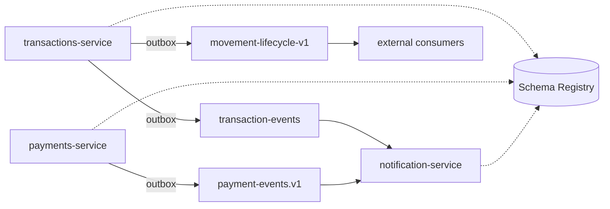

# System Architecture & Traffic Flow

Interactive Archify diagrams for the runtime topology, transfer path, and
event pipeline are under [`docs/architecture/`](docs/architecture/).

## Local Development with Colima

The `kubernetes/overlays/local/` overlay uses the same base manifests and namespace (`banking-app`) as the default stack. It does not override container images; services use the published images from the base manifests (e.g. `ghcr.io/dipjyotimetia/distributed-systems/...`).

To run against images built locally (e.g. `localhost:5000/...`), build and tag images, run a local registry if needed, then patch deployments or use `kubectl set image` to point at your registry.

```bash
# Example: deploy the local overlay (same images as base unless you patch)
kubectl apply -k kubernetes/overlays/local/

# Optional: local registry for custom tags (tag matches root VERSION)
docker run -d -p 5000:5000 --name registry registry:2
docker tag ghcr.io/dipjyotimetia/distributed-systems/frontend:v1.4.139 localhost:5000/frontend:v1.4.139
docker push localhost:5000/frontend:v1.4.139
```

## Traffic Flow Design
Browser banking requests flow through the frontend server. The AI chat proxy uses `AI_SERVICE_URL` to call AI service directly. Durable agent mode (`mode=agent`) starts Temporal workflows on the `ai-banking` task queue (LiteLLM activity, post-LLM guardrails, read-only banking tools, claim-check for large conversation history). Dispute investigation can start `disputeResearchV1` on that queue; the AI draft is stored on `disputes.cases.ai_draft` and signals `caseChangedV1` for operator HITL.

```
Client → Frontend Service → API Gateway → Backend Services
```

`contracts/proto/` is the protobuf contract for gRPC APIs, next to the OpenAPI files in `contracts/openapi/`. KYC is `contracts/proto/kyc/kyc.proto` and cards is `contracts/proto/cards/cards.proto`. `scripts/frontend-proto.sh` writes the checked-in TypeScript under `frontend/src/gen` with Buf 1.75.0 and `protoc-gen-es` 2.16.0. Next.js route handlers import those stubs and call the Go servers with the gRPC protocol. The browser uses the HTTP routes. Those routes forward the incoming `Authorization` header as gRPC metadata.

Kafka event shapes live under [`contracts/avro/`](contracts/avro/README.md) (not protobuf). Producers and notification-service use Confluent wire-format Avro via Redpanda Schema Registry (`SCHEMA_REGISTRY_URL`, default `http://banking-kafka:8081`).

KYC stores the case and starts a Temporal review on the `kyc-review` task queue. Cards calls `fraud-service` over gRPC and the accounts ledger over gRPC (`ACCOUNTS_GRPC_ADDRESS`, default `accounts-service:9092`) before it issues a card. `docker-compose.mtls.yml` is the optional mutual TLS overlay for the frontend, KYC, cards, and fraud clients.

## Application services and infrastructure

See the [deployment matrix](README.md#quick-start) for which services each environment runs.

The application backend services are `api-gateway`, `user-service`,
`accounts-service`, `transactions-service`, `fraud-service`,
`kyc-service`, `cards-service`, `notification-service`,
`disputes-service`, `ai-service`, and the optional `payments-service`.
MongoDB provides infrastructure
for notification event storage. Redpanda carries `transaction-events`,
`payment-events.v1`, and `movement-lifecycle-v1` (Confluent Avro via Schema
Registry by default; set `KAFKA_VALUE_FORMAT=json` for UTF-8 JSON). Schemas and
codegen are documented in [`contracts/avro/README.md`](contracts/avro/README.md).
PostgreSQL stores identity, account, transaction, dispute, and payment data.



Local Compose uses one PostgreSQL database with a schema per service
(`user_service`, `accounts_service`, `transactions_service`, `payments`,
`disputes`). That is a demo shortcut. A new service should still treat its
schema as private and should not read another service's tables.

Completed ledger movements record an `Idempotency-Key` when the client sends
one, and write `transaction-events` through `transactions_service.event_outbox`
in the same database transaction as the ledger row. The outbox publisher claims
one row at a time with a short `FOR UPDATE SKIP LOCKED` transaction (Kafka I/O
outside the lock), quarantines poison payloads after repeated failures
(`failed_at`), and deletes published/quarantined rows after a retention window.
`movement-lifecycle-v1` remains for external consumers (dedupe by `eventId`);
notification-service consumes `transaction-events` and, on the payments overlay,
`payment-events.v1`. Fraud screening fails open unless `FRAUD_FAIL_OPEN=false`.
The gateway fault filter stays off unless `FAULT_INJECTION_RATE` is set above
zero. Default Compose runs `ai-service` in fixture mode so chat does not call
live LLM providers. `payments-service` stays on the Artemis and payments Compose
overlays.

### Internal gRPC and Temporal workers

| Contract | Default address | Callers |
|---|---|---|
| Accounts ledger (`contracts/proto/ledger/ledger.proto`) | `accounts-service:9092` | transactions-service, cards-service |
| Transactions query (`contracts/proto/transactions/query.proto`) | `transactions-service:9095` | disputes-service |
| Dispute research (`contracts/proto/disputes/research.proto`) | disputes research port | ai-worker / dispute research path |
| KYC / cards / fraud | `:8091` / `:8092` / h2c `:8080` | frontend (KYC/cards), cards→fraud, transactions→fraud |

Local Compose shares one Temporal development server (SQLite on a named
volume). Task queues and workers:

| Queue | Worker process |
|---|---|
| `disputes-escalation` | `disputes-worker` |
| `accounts-statement-exports` | `statement-worker` (accounts-service image) |
| `kyc-review` | `kyc-worker` |
| `ai-banking` | `ai-worker` |
| payments queues | `payments-worker` (payments overlay only) |

The disputes API verifies transfer eligibility over transactions query gRPC
(`TRANSACTIONS_GRPC_ADDRESS`) using the caller's JWT. PostgreSQL stores the
case and workflow start together. Evidence requests, responses, and
resolutions update the case and its signal outbox atomically. The
investigation workflow carries only the case ID and revision, and reloads
deadlines and status through an activity. The legacy escalation workflow
stays registered, and both escalation paths guard against changing resolved
cases.

Accounts-service stores statement jobs and workflow starts together in
PostgreSQL. A separate Java process runs export workflows on a dedicated task
queue. Activity results carry the expiry timestamp, while the generated
JSON stays in PostgreSQL. Downloads check ownership and expiry on each call.

## Architecture Principles

- **Frontend as Proxy**: Frontend contains Next.js API routes that proxy requests to the API Gateway
- **Server-Side Communication**: Backend communication uses internal Kubernetes service URLs (e.g., `http://api-gateway:8080`)
- **Relative Client URLs**: Frontend client code uses relative URLs (`/api/v1/users/login`) that route to Next.js API handlers
- **Environment Agnostic**: No hardcoded URLs in client-side code, eliminating `NEXT_PUBLIC_API_URL` configuration issues

## Benefits

- Simplified client configuration (no environment-specific URLs)
- Proper separation of concerns between client and server
- Security through single entry point
- Consistent request/response handling and logging

## Observability

Compose and Kubernetes both export through the OpenTelemetry Collector, which
filters actuator and Spring Security noise before Jaeger. Compose uses
[`config/otel-collector.yaml`](config/otel-collector.yaml); Kubernetes uses
[`kubernetes/observability/otel-collector.yaml`](kubernetes/observability/otel-collector.yaml).
The frontend uses OTLP over HTTP/protobuf. Java services use OTLP over gRPC in
the supplied deployment configurations. See
[OTel trace data processing](OBSERVABILITY.md#opentelemetry-trace-data-processing)
for the pipeline and signal-specific configuration.

## Versioning and repository workflow

[AGENTS.md](AGENTS.md#version-bump-policy) defines release versioning and
repository conventions. [plan.md](plan.md) records delivery milestones and
remaining production work.
